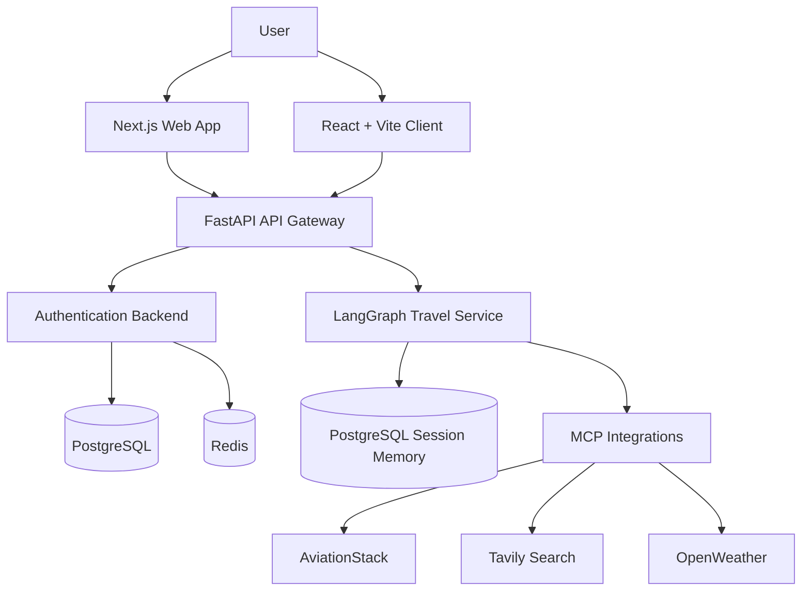

# LAB 3: Software Design Document

## Project: Ascend.ai – AI-Powered Travel Planning Platform

**Version:** 1.0  
**Prepared by:** Project Team  
**Repository:** [Pranav-789/SE](https://github.com/Pranav-789/SE)

## 1. Introduction

### 1.1 Purpose
This document describes the architecture, modules, data design, user interface, and technical design of Ascend.ai.

### 1.2 Scope
Ascend.ai is a web-based platform that uses AI agents to help users plan trips, explore flight and hotel information, consider weather and budgets, and generate itineraries.

## 2. System Architecture

The system follows a modular, microservice-based architecture. The frontend communicates with backend services through HTTP APIs and an API gateway.

### Main components

- **Frontend:** Next.js dashboard and a separate React + Vite client for travel planning.
- **API Gateway:** Routes requests to the appropriate backend service and handles common request concerns.
- **Authentication Backend:** Manages login, user sessions, email verification, password resets, and rate limiting integration.
- **Travel Service:** Uses LangGraph to coordinate specialist agents and create travel plans.
- **External Services:** Supply flight, hotel-search, and weather information.
- **Data Stores:** PostgreSQL supports application/session persistence; Redis supports rate limiting. The travel service also documents local flight datasets.

## 3. Module Design

| Module | Responsibility |
|---|---|
| User Interface | Collects user input and displays travel plans and responses |
| Authentication | Handles login, authentication cookies, and account-related flows |
| API Gateway | Routes requests between clients and backend services |
| Supervisor Agent | Routes queries and coordinates specialist agents with guardrails |
| Flight Agent | Retrieves flight details, with local-data fallback where supported |
| Hotel Agent | Searches for accommodation information |
| Weather Agent | Retrieves destination weather information |
| Budget Agent | Organizes estimated costs and checks the stated budget |
| Itinerary Agent | Combines available results into a day-by-day itinerary |
| Session and Data Layer | Stores configured user/session data and supports continuing conversations |

The travel service includes a human-in-the-loop workflow so a user can review a proposed plan and approve it or request changes.

## 4. Database Design

The repository documentation identifies PostgreSQL, Redis, and a local SQLite flight database. The following describes their intended roles. Exact table schemas should follow the implemented models and migrations.

### 4.1 PostgreSQL

- Stores user/application data as configured by the authentication backend.
- Supports persistent LangGraph session checkpoints for multi-turn travel planning.
- Keeps conversation/session state available when the user resumes a supported workflow.

### 4.2 Redis

- Supports rate limiting by IP address and user ID.
- Holds rate-limit state rather than serving as the primary relational database.

### 4.3 Local Flight Database

- The travel service documents a local SQLite flight database and airport/airline data.
- It can provide fallback flight information where the implemented workflow supports it.

### Conceptual data entities

| Entity | Purpose | Key information (conceptual) |
|---|---|---|
| User | Represents an account | User ID, account details, authentication-related fields |
| Travel Session | Represents a planning conversation | Session/thread ID, user association where applicable, state |
| Travel Request | Represents a submitted query | Request ID, query, destination/travel preferences |
| Itinerary | Represents a proposed travel plan | Itinerary ID, session/request association, plan details |
| Flight Data | Represents local flight records | Flight/airline/airport information |

**Note:** This is a conceptual design, not a claim that these exact table names or columns exist in the current database.

## 5. User Interface Design

The project documentation describes the following interfaces:

1. **Main Dashboard:** Provides access to the integrated AI travel-planning feature.
2. **Authentication Screens:** Allow users to sign in and access account-related functionality.
3. **Travel Planner:** Accepts a travel query and displays the generated response or itinerary.
4. **Agent Pipeline View:** The standalone React client provides a visual view of the travel-planning workflow and endpoint options.
5. **Review and Revision Flow:** Presents a proposed plan for approval or revision where the human-in-the-loop workflow is active.

The interface should use clear labels, show loading and error states, and present results in a readable format.

## 6. Interface and API Design

The services communicate using HTTP APIs. The documented endpoints include:

| Endpoint | Method | Purpose |
|---|---|---|
| `/auth/login` | POST | User login |
| `/travel/ask` | POST | Submit a travel-planning request through the backend |
| `/ask` | POST | Execute the travel-planning service directly |
| `/travelService/ask` | POST | Route a travel request through the gateway |

The gateway also documents a shorthand `/travel/ask` route. Actual request and response schemas should be taken from the corresponding API implementation.

## 7. Technology Stack

| Layer | Technology |
|---|---|
| Main web frontend | Next.js, React, Shadcn UI |
| Standalone frontend | React, Vite |
| Backend services | Python, FastAPI |
| Agent orchestration | LangGraph |
| Tool integration | FastMCP / Model Context Protocol (MCP) |
| Relational and session persistence | PostgreSQL |
| Rate limiting | Redis |
| Local flight data | SQLite and CSV/data files |
| External information | AviationStack, Tavily, OpenWeather |
| API communication | HTTP/JSON where applicable |

## 8. Security and Error Handling

- Authentication uses JWT-based sessions and HTTP-only cookies as documented.
- Redis-based rate limiting helps limit excessive requests.
- Secret keys and external API credentials should be stored in environment variables and not committed to the repository.
- Services should handle timeouts, invalid requests, unavailable external APIs, and failed responses gracefully.
- The travel service should use its documented fallback data where supported.

## 9. Design Considerations

- **Modularity:** Each service has a defined responsibility and can be developed or tested separately.
- **Maintainability:** API contracts and configuration should be documented and kept consistent.
- **Reliability:** External service failures should not crash the entire application.
- **Testability:** Agents, API endpoints, authentication, and service integrations should be tested independently.
- **Scalability:** Services can be optimized or deployed separately as project requirements grow.

## 10. Conclusion

Ascend.ai uses a modular architecture that combines web interfaces, an API gateway, authentication, and a LangGraph-based multi-agent travel service. This design separates responsibilities, supports integration with external travel information providers, and makes the system easier to test and maintain.

## References

1. [Project Repository](https://github.com/Pranav-789/SE)
2. [Ascend.ai Architecture and Setup Documentation](https://github.com/Pranav-789/SE/blob/main/Ascend.ai/README.md)
3. [Software Design Document Template](https://wildart.github.io/MISG5020/standards/SDD_Template.pdf)
