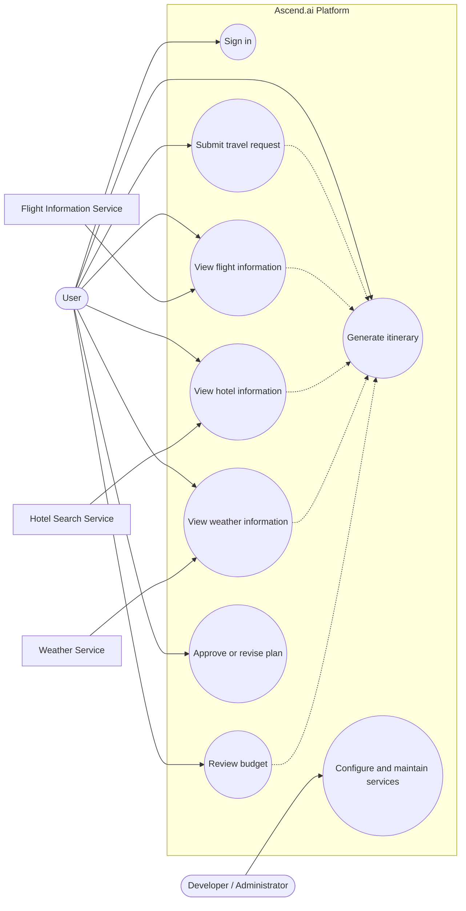
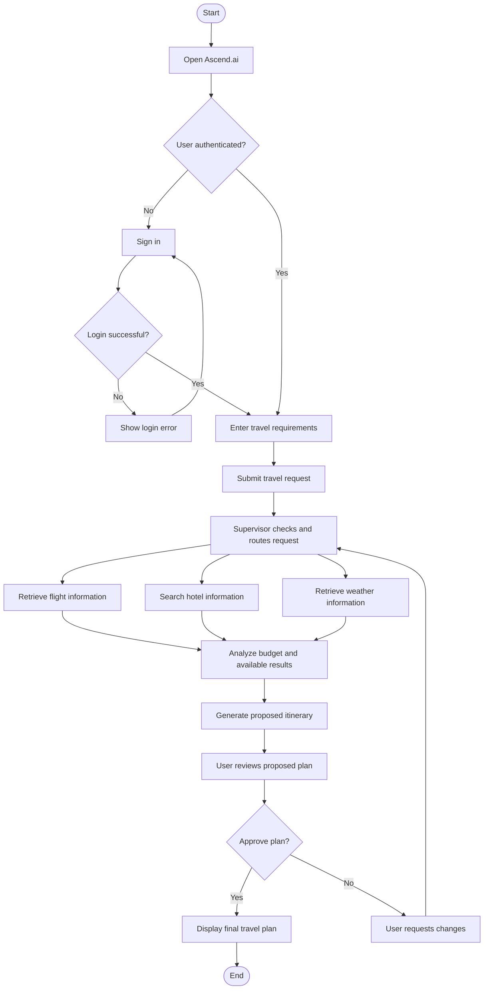

# LAB 4: UML Diagrams

## Project: Ascend.ai – AI-Powered Travel Planning Platform

**Repository:** [Pranav-789/SE](https://github.com/Pranav-789/SE)

## Aim

To draw the **Use-Case Diagram** and **Activity Diagram** for the Ascend.ai project.

## 1. Use-Case Diagram

The diagram shows how a user interacts with Ascend.ai to sign in, submit a travel-planning request, view information, and review the generated itinerary. External travel-information services provide data to the system.

**Actors**
- **User:** Signs in, submits travel queries, and reviews the travel plan.
- **Developer/Administrator:** Configures and maintains application services.
- **External services:** Provide flight, hotel-search, and weather data.

## 2. Activity Diagram

The activity diagram describes the main flow from submitting a travel request to receiving and reviewing the generated plan.

## Conclusion

The use-case diagram identifies the main users and their interactions with Ascend.ai. The activity diagram shows the key workflow for creating and reviewing an AI-generated travel plan.

**Note:** These diagrams are based on the features described in the repository README. They are high-level UML-style diagrams written in Mermaid syntax so they can be rendered in GitHub Markdown.
