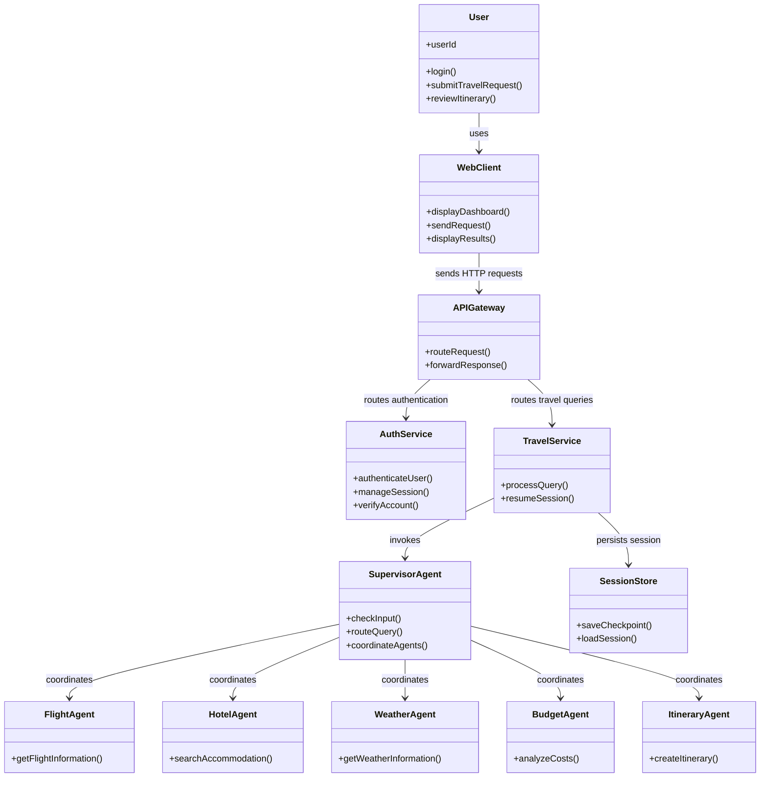
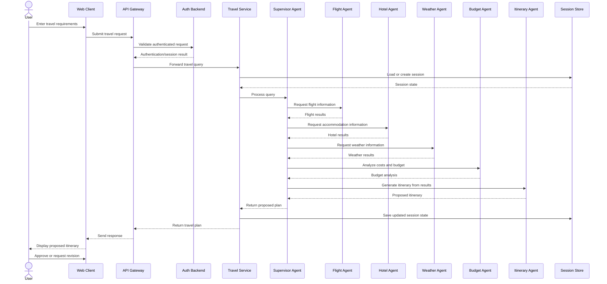

# LAB 5: UML Class and Sequence Diagrams

## Project: Ascend.ai – AI-Powered Travel Planning Platform

**Repository:** [Pranav-789/SE](https://github.com/Pranav-789/SE)

## Aim

To represent the main components and interactions of Ascend.ai using a **Class Diagram** and a **Sequence Diagram**.

## 1. Class Diagram

The class diagram below is a high-level, conceptual design based on the modules described in the repository README. It shows the main responsibilities and relationships; it does not claim that these exact class names exist in the source code.

### Main classes/modules

- **WebClient:** Collects travel requirements and displays results.
- **APIGateway:** Routes client requests to backend services.
- **AuthService:** Handles authentication and user sessions.
- **TravelService:** Runs the LangGraph travel-planning workflow.
- **SupervisorAgent:** Checks and routes requests to specialist agents.
- **FlightAgent, HotelAgent, WeatherAgent:** Retrieve relevant travel information.
- **BudgetAgent:** Organizes cost estimates against the user's budget.
- **ItineraryAgent:** Combines results into a proposed itinerary.
- **SessionStore:** Represents the configured persistence used to resume supported conversations.

## 2. Sequence Diagram

The sequence diagram shows the typical flow when a user submits a travel-planning request and reviews the generated itinerary.

**Note:** The sequence is a simplified logical flow. The repository documents authentication, the gateway, LangGraph agents, and PostgreSQL session persistence; exact internal calls may vary by implementation and configuration.

## Conclusion

The class diagram summarizes the responsibilities and relationships among Ascend.ai's main modules. The sequence diagram illustrates how a travel request moves through the client, gateway, authentication layer, and multi-agent travel service to produce a proposed itinerary.

## Reference

- [Ascend.ai Project Repository and Architecture](https://github.com/Pranav-789/SE/blob/main/Ascend.ai/README.md)
